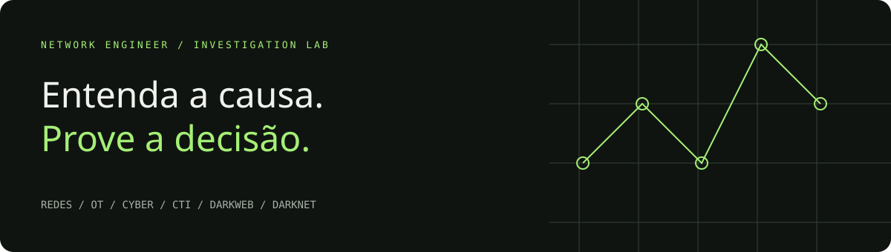

<p align="center"></p>

# Network Engineer

**Laboratórios de diagnóstico, decisão e investigação para redes, OT, cyber e inteligência.**

  

Aprenda a relacionar sintomas, configurações, evidências e consequências. Abra um caso, inspecione os registros, escolha uma intervenção e verifique se a solução preserva os requisitos do ambiente.

> **Status: MVP funcional de exercícios por regras.** Não é um emulador de redes, PLCs ou redes de anonimato. Os 20 casos são interativos, com estados e avaliações determinísticas; não são os 174 cenários de protocolo do Simul-Net. Todo o conjunto de evidências é sintético.

## Acessar o laboratório

[**Abrir Network Engineer**](https://networkengineer-lab.deivison.chatgpt.site) — versão hospedada com acesso privado do proprietário. GitHub Pages permanece como opção separada, ainda não ativada por esta entrega.

## Começar

Sem dependências de runtime, CDNs ou instalação npm:

```bash
git clone https://github.com/Ridd1kulusC0d3r/networkengineer.git
cd networkengineer
python3 -m http.server 8000 --bind 127.0.0.2
```

Abra **http://localhost:8000**. É necessário servir por HTTP: módulos JavaScript não devem ser abertos diretamente por `file://`.

Com Node.js 22 ou superior:

```bash
npm test       # invariantes, regressões e soluções dos 20 casos
npm run build # gera dist/ para hospedagem estática
```

## Seis trilhas, uma bancada

| Trilha | Casos implementados | O que é avaliado |
|---|---|---|
| Redes | DNS bloqueado; DHCP snooping | Recuperação de conectividade sem romper segmentação |
| OT | Conduíte HMI/PLC; escrita fora da janela | Supervisão, controle local e política de acesso |
| Cyber | Contenção de endpoint; TLS; sessões; ransomware; restauração; segredos; WAF; armazenamento; triagem; fadiga MFA | Contenção específica, continuidade e identidade |
| CTI | IP compartilhado; indicador antigo | Atribuição, confiança, temporalidade e proveniência |
| Darkweb | Alegação de vazamento; espelho ou clone | Corroboração e independência das fontes |
| Darknet | Onion sem exit relay; indisponibilidade I2P | Modelo de caminho e limites da inferência |

**Darkweb** é a trilha de conteúdo e evidências. **Darknet** é a trilha de redes sobrepostas, aqui Tor/I2P. O termo darknet também pode designar espaço IP não utilizado em telemetria; esse sentido não é usado nos casos atuais. Nenhum uso dessas redes é tratado, por si só, como sinal de crime.

## Fluxo de trabalho

1. Escolha uma trilha ou procure por título/descrição.
2. Leia a missão e o mapa conceitual.
3. Abra E1–E3: cada evidência informa sua origem sintética.
4. Aplique decisões e observe os estados e o registro de eventos.
5. Escreva sua hipótese e suas incertezas.
6. Verifique os requisitos e exporte um relatório JSON.

A avaliação verifica o estado e a inspeção de todas as evidências. O texto livre **não** é avaliado automaticamente. As respostas são inspecionáveis no código: este é um ambiente de autoestudo, não uma plataforma de prova antifraude.

O progresso é salvo em `localStorage`, por cenário e versão. Não há conta, backend, coleta de dados ou envio de anotações. A exportação inclui apenas as evidências abertas, as ações, o estado, as referências e a avaliação atual. Excluir os dados do navegador remove o progresso local.

## Documentação

- [Catálogo completo e evolução por trilha](docs/SCENARIOS.md)
- [Benchmark crítico e decisões de produto](docs/BENCHMARK.md)
- [Arquitetura e contrato de cenário](docs/ARCHITECTURE.md)
- [Roadmap e critérios de aceite](docs/ROADMAP.md)
- [Referências e proveniência](docs/SOURCES.md)
- [Contribuir com um laboratório](CONTRIBUTING.md)

## Publicação

O projeto pode ser hospedado em qualquer servidor estático. O workflow `ci.yml` verifica o motor e o build. O workflow `pages.yml` é **manual**: antes de executá-lo, configure GitHub Pages → Source → GitHub Actions. A existência do workflow não confirma que Pages esteja habilitado ou que exista uma URL publicada.

## Limites atuais

- Modelos por regras; sem pilha de protocolos, timers, sockets, CLI real ou PCAP.
- A topologia é conceitual e fixa; não há editor drag-and-drop.
- Modelos OT não simulam dinâmica física ou implementação de dispositivos.
- Confiança e vereditos são decisões explícitas; nenhum algoritmo atribui adversários.
- Sem scraping darkweb, integração Tor/I2P, MISP/OpenCTI ou exportação STIX neste release.
- Motor verificado por testes automatizados. Validação visual em navegador permanece pendente nesta primeira entrega.

## Origem

Implementação original. [Simul-Net](https://github.com/peotta/Simul-Net) e os projetos do benchmark são referências conceituais; nenhum código deles foi incorporado. Não há afiliação ou endosso dos projetos citados. Licença MIT para este código — consulte [LICENSE](LICENSE).
